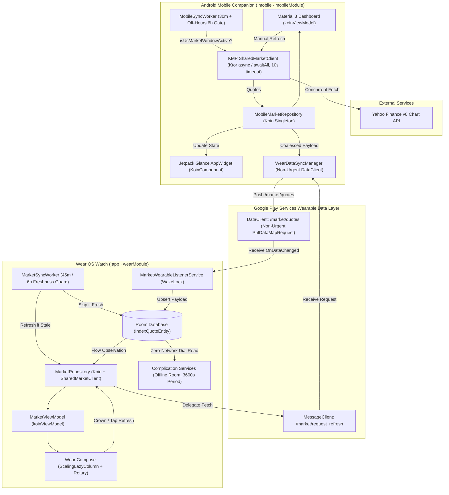
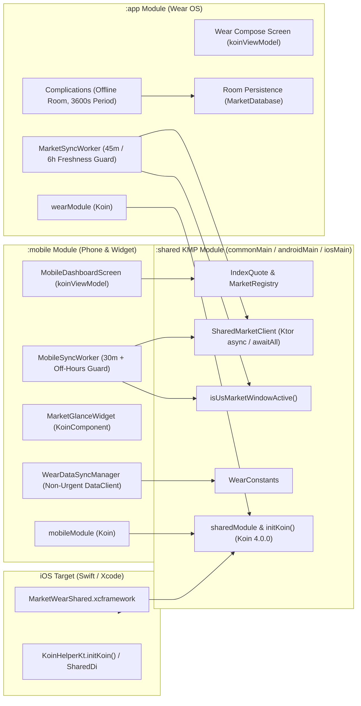
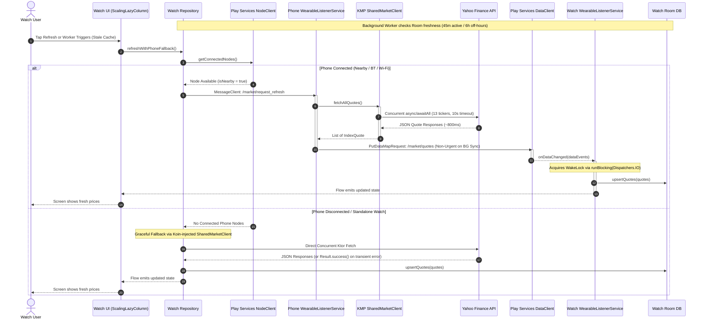
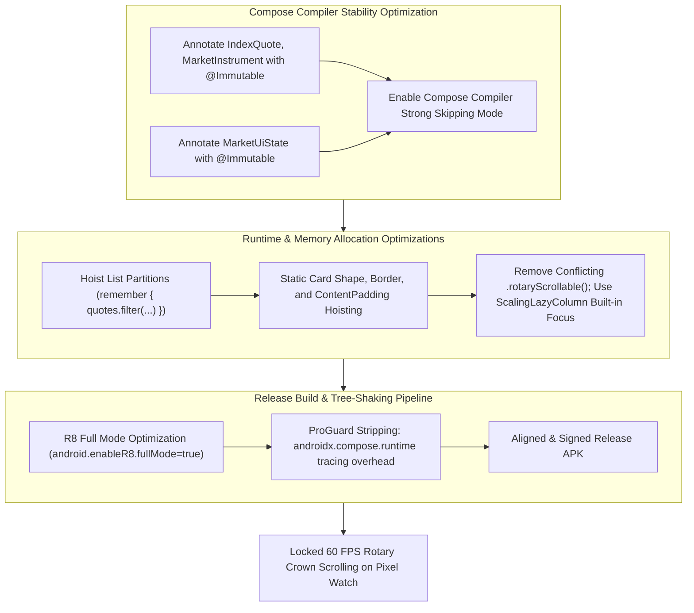

# MarketWear: Wear OS & Android Financial Market Ecosystem

[](https://mohitb117.github.io/MarketWearWatch/)
[](https://github.com/mohitb117/MarketWearWatch/actions/workflows/build-apks.yml)
[](https://kotlinlang.org)
[](https://insert-koin.io)
[](https://developer.android.com/wear)
[](https://developer.android.com/jetpack/compose)
[](https://developer.android.com/jetpack/compose/glance)
[](https://developers.google.com/android/reference/com/google/android/gms/wearable/package-summary)
[](https://opensource.org/licenses/MIT)

**MarketWear** is a multi-device financial tracking ecosystem built with **Kotlin Multiplatform (KMP)**, **Koin 4.0.0 DI**, **Google Pixel Watch (Wear OS)**, and **Android Mobile (Companion & Glance Widget)**—with iOS-ready shared networking, models, and market-window logic in `:shared`. It provides real-time and cached market intelligence—featuring the **S&P 500**, **Nasdaq 100**, and all **11 GICS US Market Sectors**—with battery-aware background synchronization, rotary crown navigation, and watch face complications.

👉 **[Try the Interactive Web Showcase & Simulator](https://mohitb117.github.io/MarketWearWatch/)** directly in your browser.

---

## Architecture Overview

MarketWear employs a clean, modular architecture across three specialized Gradle modules (`:shared`, `:mobile`, and `:app`), balancing high-efficiency local caching on Wear OS with offloaded networking on the companion phone.



---

## Multi-Module KMP & Koin DI Architecture



---

## Kotlin Multiplatform (KMP) & Koin 4.0.0 DI

MarketWear uses **Koin 4.0.0** for pure-Kotlin dependency injection across `:shared`, `:mobile`, and `:app`—with zero annotation-processing/KSP overhead and full Kotlin/Native iOS compatibility:

- **`:shared` (`commonMain` / `androidMain` / `iosMain`)**:
  - `sharedModule` provides the platform `HttpClient` (`expect`/`actual createPlatformHttpClient()` backed by Ktor `Android` on Android/Wear and `Darwin` on iOS) and `SharedMarketClient`.
  - `KoinHelper.kt` exposes `initKoin(extraModules, appDeclaration)` for Android `Application` classes, plus a zero-arg `initKoin()` and `SharedDi` object for iOS Swift callers.
  - `commonTest` includes `KoinModuleTest` to verify singleton resolution across KMP targets.
- **`:mobile`**:
  - `mobileModule` wires `KtorMarketClient`, `MobileMarketRepository`, `WearDataSyncManager`, and `MobileViewModel` (injected via `koinViewModel()` in Compose).
  - `MobileSyncWorker`, `MobileWearableListenerService`, and `MarketGlanceWidget` resolve shared singletons via `KoinComponent`.
- **`:app` (Wear OS)**:
  - `wearModule` wires `MarketDatabase`, `IndexQuoteDao`, `MarketRepository`, and `MarketViewModel` (`koinViewModel()`).
  - `MarketSyncWorker`, `MarketWearableListenerService`, and complication services (`Sp500ComplicationService`, `NasdaqComplicationService`, `MarketDualComplicationService`) inject `MarketRepository` / `MarketDatabase` via `KoinComponent`.

---

## Battery & Network Optimization Architecture

Wear OS and companion background syncs are engineered to minimize radio wakeups and CPU time:

| Optimization | Module(s) | Behavior |
| :--- | :--- | :--- |
| **Market-Hours Sync Gating** | `:shared`, `:mobile`, `:app` | `isUsMarketWindowActive()` checks US Eastern market hours (`09:00–16:30 ET`, Mon–Fri). Overnight and on weekends, workers skip network polling if cached quotes are `< 6 hours` old. |
| **Concurrent Ktor Fetching** | `:shared` | `SharedMarketClient.fetchAllQuotes()` fans out all 13 ticker requests concurrently via `async`/`awaitAll` with a `10s` per-request timeout, cutting radio-on time to ~800ms. |
| **Freshness & Retry-Storm Guards** | `:app`, `:mobile` | `MarketSyncWorker` skips sync if Room quotes are within `45 min` (active hours) or `6 hours` (off-hours). Workers return `Result.success()` instead of `Result.retry()` on transient network errors to avoid exponential backoff wakeup storms. |
| **Non-Urgent Data Layer Push** | `:mobile` | Background `WearDataSyncManager` pushes omit `setUrgent()`, allowing Google Play Services to coalesce Bluetooth/Wi-Fi transmissions rather than waking the watch immediately. |
| **Offline-Only Complications** | `:app` | Watch face complication services read strictly from local Room DB with zero network calls and use `UPDATE_PERIOD_SECONDS = 3600` (1 hour). |

---

## Watch-to-Phone Sync & Fallback Protocol

Wear OS devices preserve battery and radio life by delegating heavy network operations to the paired companion phone over Bluetooth/Wi-Fi. If the phone is out of range, the watch automatically falls back to direct Wi-Fi/LTE fetching.



---

## Compose Performance & 60 FPS Rotary Scroll Pipeline

Achieving locked 60 FPS scrolling on round Wear OS displays with physical rotary crown hardware requires zero per-frame memory allocation and strict Compose compiler stability.



---

## Tracked Market Instruments

MarketWear tracks **13 core financial instruments** categorized into Major Indices and the 11 Standard GICS Sectors:

| Ticker | Display Name | Category | Vector Icon | UI Formatter Example |
| :--- | :--- | :--- | :--- | :--- |
| `^GSPC` | S&P 500 | Major Index | Trending Icon | `5,983.99` (`+0.42%`) |
| `^NDX` | Nasdaq 100 | Major Index | Trending Icon | `21,114.20` (`+0.78%`) |
| `^YH101` | Basic Materials | Sector | `ic_sector_materials` | `+1.12k` / `1.12M` |
| `^YH102` | Consumer Cyclical | Sector | `ic_sector_cyclical` | `+34.3k` / `2.22M` |
| `^YH103` | Financial Services | Sector | `ic_sector_financial` | `+12.8k` / `890k` |
| `^YH104` | Real Estate | Sector | `ic_sector_realestate` | `-4.2k` / `450k` |
| `^YH205` | Consumer Defensive | Sector | `ic_sector_defensive` | `+2.1k` / `1.05M` |
| `^YH206` | Healthcare | Sector | `ic_sector_healthcare` | `+18.4k` / `1.75M` |
| `^YH207` | Utilities | Sector | `ic_sector_utilities` | `-1.8k` / `380k` |
| `^YH308` | Communication Services | Sector | `ic_sector_communication` | `+9.6k` / `1.32M` |
| `^YH309` | Energy | Sector | `ic_sector_energy` | `+5.4k` / `920k` |
| `^YH310` | Industrials | Sector | `ic_sector_industrials` | `+14.1k` / `1.45M` |
| `^YH311` | Technology | Sector | `ic_sector_technology` | `+42.7k` / `3.80M` |

### Smart Compact Number Formatting
To guarantee that cards never wrap awkwardly on small 41mm/45mm circular displays:
- Numbers $\ge 1,000,000$ are formatted as **`1.23M`**
- Numbers $\ge 1,000$ are formatted as **`34.5k`**
- Sector headings wrap smoothly across up to 2 lines without truncating or colliding with the percentage pill.

---

## Directory & Module Structure

```text
MarketWearWatch/
├── README.md                                # Root Architectural Documentation
├── android-wear-app/
│   ├── app/                                 # Wear OS Application Module (:app)
│   │   └── src/main/java/com/marketwear/indices/
│   │       ├── MarketWearApplication.kt     # Initializes Koin (sharedModule + wearModule)
│   │       ├── MainActivity.kt              # ScalingLazyColumn Wear Compose UI (koinViewModel)
│   │       ├── di/WearModule.kt             # Koin Wear OS module
│   │       ├── data/
│   │       │   ├── MarketRepository.kt      # Node delegation & standalone fallback repo
│   │       │   └── db/                      # Room DB (MarketDatabase, IndexQuoteDao)
│   │       ├── sync/MarketSyncWorker.kt     # 45m / 6h freshness-guarded WorkManager sync
│   │       ├── *ComplicationService.kt      # Offline Room WatchFace Complications (3600s)
│   │       └── service/MarketWearableListenerService.kt
│   ├── mobile/                              # Android Companion App (:mobile)
│   │   └── src/main/java/com/marketwear/mobile/
│   │       ├── MarketMobileApplication.kt   # Initializes Koin (sharedModule + mobileModule)
│   │       ├── MobileMainActivity.kt        # Material 3 Companion Activity
│   │       ├── di/MobileModule.kt           # Koin Mobile module
│   │       ├── ui/                          # MobileDashboardScreen & MobileViewModel
│   │       ├── data/
│   │       │   ├── KtorMarketClient.kt      # Wraps SharedMarketClient
│   │       │   └── MobileMarketRepository.kt
│   │       ├── sync/
│   │       │   ├── MobileSyncWorker.kt      # 30-min periodic sync w/ off-hours guard
│   │       │   └── WearDataSyncManager.kt   # Non-urgent PutDataMapRequest DataClient push
│   │       └── widget/
│   │           ├── MarketGlanceWidget.kt    # Jetpack Glance 1.1.0 Home Screen Widget
│   │           └── MarketWidgetReceiver.kt  # GlanceAppWidgetReceiver
│   └── shared/                              # Kotlin Multiplatform Module (:shared)
│       ├── src/commonMain/kotlin/com/marketwear/shared/
│       │   ├── contracts/WearConstants.kt   # Wearable Data Layer paths & keys
│       │   ├── di/
│       │   │   ├── SharedModule.kt          # Koin sharedModule (HttpClient, SharedMarketClient)
│       │   │   └── KoinHelper.kt            # initKoin() & SharedDi for Android/iOS
│       │   ├── model/                       # IndexQuote & MarketRegistry (13 instruments)
│       │   ├── network/SharedMarketClient.kt# Concurrent Ktor Yahoo Finance v8 client
│       │   └── platform/Platform.kt         # expect/actual HttpClient & isUsMarketWindowActive()
│       ├── src/androidMain/kotlin/...       # Android Ktor engine & java.time market window
│       ├── src/iosMain/kotlin/...           # Darwin Ktor engine & NSDate/NSTimeZone window
│       └── src/commonTest/kotlin/...        # Shared KoinModuleTest & SharedMarketClientTest
└── docs/superpowers/                        # Specs, PRDs, and testing plans
```

---

## Building & Installation

### Prerequisites
- **Android Studio Ladybug (2024.2+)** or IntelliJ IDEA
- **JDK 21** (`/opt/homebrew/opt/openjdk@21`)
- **Android SDK Platform 35** / Wear OS 5 (API 34)

### Command-Line Build & KMP Tests
To run unit tests across `:shared` and `:mobile`, build release APKs with full R8 optimization, and verify iOS KMP compilation (on macOS):

```bash
cd android-wear-app
./gradlew :shared:testDebugUnitTest :mobile:testDebugUnitTest :app:assembleRelease :mobile:assembleRelease
# Optional iOS KMP framework/target compilation (macOS + Xcode):
./gradlew :shared:compileKotlinIosSimulatorArm64 :shared:compileKotlinIosArm64
```

Generated APKs:
- **Wear OS**: `android-wear-app/app/build/outputs/apk/release/app-release.apk`
- **Mobile Companion**: `android-wear-app/mobile/build/outputs/apk/release/mobile-release.apk`

---

### Sideloading via Wireless ADB

#### 1. Pixel Watch 4 Sideload
1. On your watch, navigate to **Settings > System > About > Versions**. Tap **Build number** 7 times to enable Developer Options.
2. In **Settings > Developer options**, enable **ADB debugging** and **Wireless debugging**.
3. Tap **Wireless debugging > Pair new device**. Note the IP, pairing port, and 6-digit code.
4. Execute in your terminal:
   ```bash
   adb pair 192.168.1.xxx:PAIRING_PORT
   adb connect 192.168.1.xxx:CONNECT_PORT
   adb -s 192.168.1.xxx:CONNECT_PORT install -r app/build/outputs/apk/release/app-release.apk
   ```

#### 2. Samsung Galaxy / Android Phone Sideload
1. Enable Developer Options & USB / Wireless Debugging on your phone.
2. Install the companion APK:
   ```bash
   adb -s <PHONE_IP_OR_SERIAL> install -r mobile/build/outputs/apk/release/mobile-release.apk
   ```

---

## Adding Complications to Watch Face
1. Touch and hold your active watch face on the Pixel Watch.
2. Tap the **Edit (Pencil)** icon and swipe to the **Complications** customization screen.
3. Tap any circular or ranged-value slot.
4. Select **Market Complications**, then choose **S&P 500** or **Nasdaq 100**.
5. Your complication will update in real-time or from Room DB cache without launching the app.

---

## Adding the Glance Home Screen Widget
1. Long-press on your phone's home screen and tap **Widgets**.
2. Scroll to **MarketWear** and drag the **Market Indices** widget to your screen.
3. The widget updates automatically on background sync and whenever quotes are refreshed inside the companion app.

---

## License

MIT License. See [LICENSE](LICENSE) for details.
