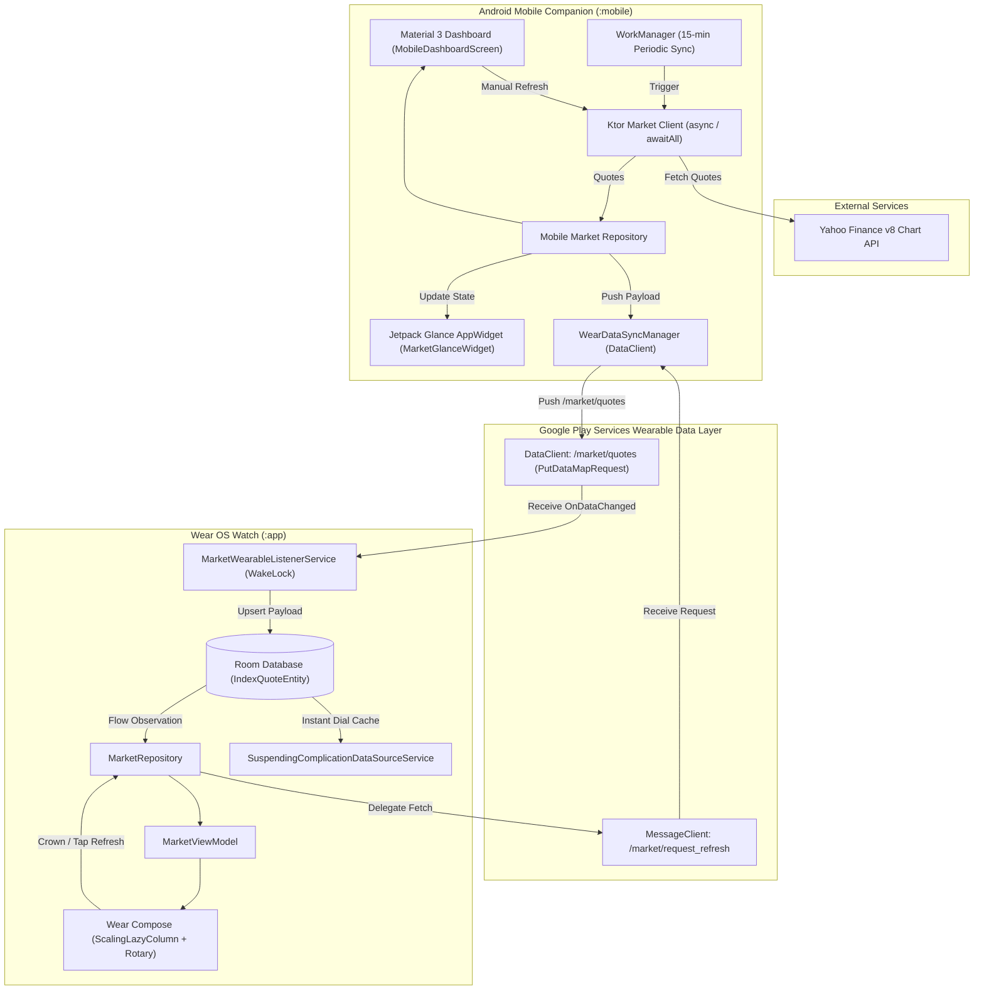
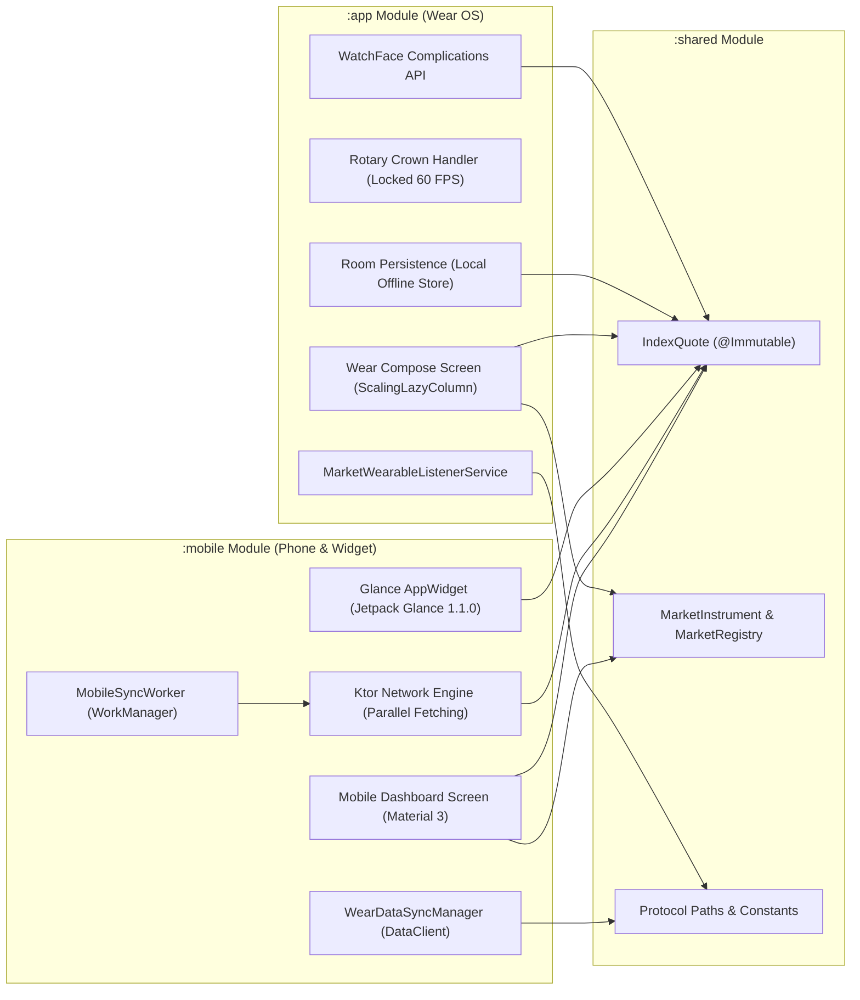
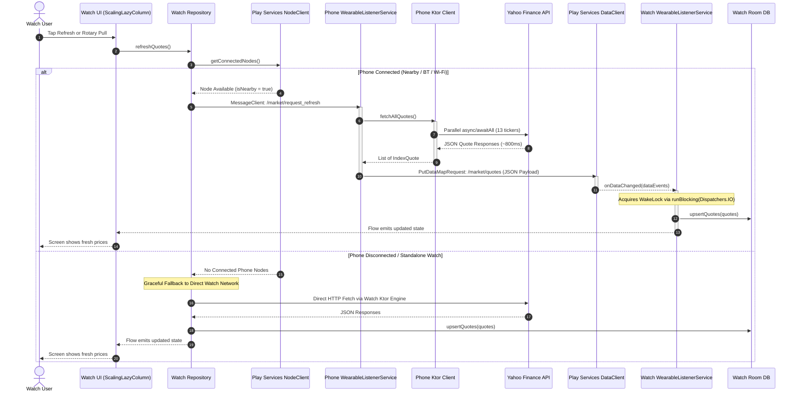
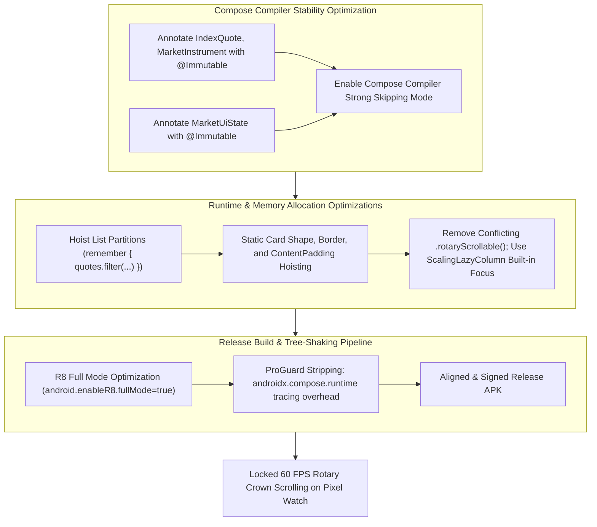

# MarketWear: Wear OS & Android Financial Market Ecosystem

[](https://mohitb117.github.io/MarketWearWatch/)
[](https://github.com/mohitb117/MarketWearWatch/actions/workflows/build-apks.yml)
[](https://kotlinlang.org)
[](https://developer.android.com/wear)
[](https://developer.android.com/jetpack/compose)
[](https://developer.android.com/jetpack/compose/glance)
[](https://developers.google.com/android/reference/com/google/android/gms/wearable/package-summary)
[](https://opensource.org/licenses/MIT)

**MarketWear** is a multi-device financial tracking ecosystem built for **Google Pixel Watch (Wear OS)** and **Android Mobile (Companion & Glance Widget)**. It provides real-time and cached market intelligence—featuring the **S&P 500**, **Nasdaq 100**, and all **11 GICS US Market Sectors**—with zero battery penalty, rotary crown navigation, watch face complications, and cross-device background synchronization.

👉 **[Try the Interactive Web Showcase & Simulator](https://mohitb117.github.io/MarketWearWatch/)** directly in your browser.

---

## Architecture Overview

MarketWear employs a clean, modular architecture across three specialized Gradle modules (`:shared`, `:mobile`, and `:app`), balancing high-efficiency local caching on Wear OS with offloaded networking on the companion phone.



---

## Multi-Module Dependency Architecture



---

## Watch-to-Phone Sync & Fallback Protocol

Wear OS devices preserve battery and radio life by delegating heavy network operations to the paired companion phone over Bluetooth/Wi-Fi. If the phone is out of range, the watch automatically falls back to direct Wi-Fi/LTE fetching.



---

## Compose Performance & 60 FPS Rotary Scroll Pipeline

Achieving locked 60 FPS scrolling on round Wear OS displays with physical rotary crown hardware requires zero per-frame memory allocation and strict Compose compiler stability.



---

## Tracked Market Instruments

MarketWear tracks **13 core financial instruments** categorized into Major Indices and the 11 Standard GICS Sectors:

| Ticker | Display Name | Category | Vector Icon | UI Formatter Example |
| :--- | :--- | :--- | :--- | :--- |
| `^GSPC` | S&P 500 | Major Index | Trending Icon | `5,983.99` (`+0.42%`) |
| `^NDX` | Nasdaq 100 | Major Index | Trending Icon | `21,114.20` (`+0.78%`) |
| `^YH101` | Basic Materials | Sector | `ic_sector_materials` | `+1.12k` / `1.12M` |
| `^YH102` | Consumer Cyclical | Sector | `ic_sector_cyclical` | `+34.3k` / `2.22M` |
| `^YH103` | Financial Services | Sector | `ic_sector_financial` | `+12.8k` / `890k` |
| `^YH104` | Real Estate | Sector | `ic_sector_realestate` | `-4.2k` / `450k` |
| `^YH205` | Consumer Defensive | Sector | `ic_sector_defensive` | `+2.1k` / `1.05M` |
| `^YH206` | Healthcare | Sector | `ic_sector_healthcare` | `+18.4k` / `1.75M` |
| `^YH207` | Utilities | Sector | `ic_sector_utilities` | `-1.8k` / `380k` |
| `^YH308` | Communication Services | Sector | `ic_sector_communication` | `+9.6k` / `1.32M` |
| `^YH309` | Energy | Sector | `ic_sector_energy` | `+5.4k` / `920k` |
| `^YH310` | Industrials | Sector | `ic_sector_industrials` | `+14.1k` / `1.45M` |
| `^YH311` | Technology | Sector | `ic_sector_technology` | `+42.7k` / `3.80M` |

### Smart Compact Number Formatting
To guarantee that cards never wrap awkwardly on small 41mm/45mm circular displays:
- Numbers $\ge 1,000,000$ are formatted as **`1.23M`**
- Numbers $\ge 1,000$ are formatted as **`34.5k`**
- Sector headings wrap smoothly across up to 2 lines without truncating or colliding with the percentage pill.

---

## Directory & Module Structure

```text
MarketWearWatch/
├── README.md                                # Root Architectural Documentation
├── android-wear-app/
│   ├── app/                                 # Wear OS Application Module (:app)
│   │   ├── src/main/java/.../indices/
│   │   │   ├── MainActivity.kt              # ScalingLazyColumn Wear Compose UI
│   │   │   ├── data/
│   │   │   │   ├── MarketRepository.kt      # Node delegation & fallback repo
│   │   │   │   ├── local/                   # Room DB (IndexQuoteDao, AppDatabase)
│   │   │   ├── complication/                # SuspendingComplicationDataSourceService
│   │   │   └── service/                     # MarketWearableListenerService (DataClient)
│   │   └── src/main/res/drawable/           # Vector icons (ic_sector_*.xml)
│   ├── mobile/                              # Android Companion App (:mobile)
│   │   ├── src/main/java/.../mobile/
│   │   │   ├── MobileMainActivity.kt        # Material 3 Companion Activity
│   │   │   ├── ui/                          # MobileDashboardScreen & ViewModels
│   │   │   ├── data/
│   │   │   │   ├── KtorMarketClient.kt      # Parallel async/awaitAll HTTP Engine
│   │   │   │   └── MobileMarketRepository.kt# WorkManager sync & quote persistence
│   │   │   ├── sync/
│   │   │   │   ├── MobileSyncWorker.kt      # 15-minute background periodic sync
│   │   │   │   └── WearDataSyncManager.kt   # PutDataMapRequest DataClient publisher
│   │   │   └── widget/
│   │   │       ├── MarketGlanceWidget.kt    # Jetpack Glance 1.1.0 Home Screen Widget
│   │   │       └── MarketWidgetReceiver.kt  # GlanceAppWidgetReceiver
│   │   └── proguard-rules.pro               # Mobile R8 rules
│   └── shared/                              # Shared Kotlin Domain Module (:shared)
│       └── src/main/java/.../shared/
│           ├── model/
│           │   ├── IndexQuote.kt            # @Immutable Quote entity
│           │   └── MarketInstrument.kt      # 13 instrument registry & sector metadata
│           └── sync/
│               └── WearableProtocol.kt      # Paths, keys, and sync contracts
└── docs/superpowers/                        # Specs, PRDs, and testing plans
```

---

## Building & Installation

### Prerequisites
- **Android Studio Ladybug (2024.2+)** or IntelliJ IDEA
- **JDK 21** (`/opt/homebrew/opt/openjdk@21`)
- **Android SDK Platform 35** / Wear OS 5 (API 34)

### Command-Line Build
To build release APKs with full R8 optimization enabled:

```bash
cd android-wear-app
./gradlew assembleRelease
```

Generated APKs:
- **Wear OS**: `android-wear-app/app/build/outputs/apk/release/app-release.apk`
- **Mobile Companion**: `android-wear-app/mobile/build/outputs/apk/release/mobile-release.apk`

---

### Sideloading via Wireless ADB

#### 1. Pixel Watch 4 Sideload
1. On your watch, navigate to **Settings > System > About > Versions**. Tap **Build number** 7 times to enable Developer Options.
2. In **Settings > Developer options**, enable **ADB debugging** and **Wireless debugging**.
3. Tap **Wireless debugging > Pair new device**. Note the IP, pairing port, and 6-digit code.
4. Execute in your terminal:
   ```bash
   adb pair 192.168.1.xxx:PAIRING_PORT
   adb connect 192.168.1.xxx:CONNECT_PORT
   adb -s 192.168.1.xxx:CONNECT_PORT install -r app/build/outputs/apk/release/app-release.apk
   ```

#### 2. Samsung Galaxy / Android Phone Sideload
1. Enable Developer Options & USB / Wireless Debugging on your phone.
2. Install the companion APK:
   ```bash
   adb -s <PHONE_IP_OR_SERIAL> install -r mobile/build/outputs/apk/release/mobile-release.apk
   ```

---

## Adding Complications to Watch Face
1. Touch and hold your active watch face on the Pixel Watch.
2. Tap the **Edit (Pencil)** icon and swipe to the **Complications** customization screen.
3. Tap any circular or ranged-value slot.
4. Select **Market Complications**, then choose **S&P 500** or **Nasdaq 100**.
5. Your complication will update in real-time or from Room DB cache without launching the app.

---

## Adding the Glance Home Screen Widget
1. Long-press on your phone's home screen and tap **Widgets**.
2. Scroll to **MarketWear** and drag the **Market Indices** widget to your screen.
3. The widget updates automatically on background sync and whenever quotes are refreshed inside the companion app.

---

## License

MIT License. See [LICENSE](LICENSE) for details.
