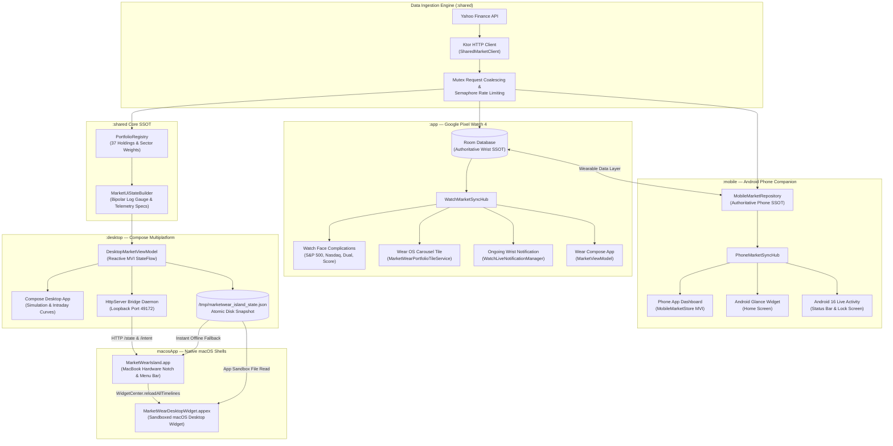

# MarketWear: Multi-Surface Financial Telemetry & Portfolio Platform

> **Obsidian Terminal Financial Intelligence** across Google Pixel Watch, Android Mobile, Compose Multiplatform Desktop, macOS Dynamic Island Notch, and native macOS Desktop Widgets.

MarketWear is a unified, battery-efficient financial index and portfolio telemetry ecosystem. It computes a real-time, center-origin portfolio score (37 institutional holdings across all 11 market sectors) and delivers instantaneous glanceable intelligence across every screen you use.

---

## 🏛 Multi-Surface Architecture & Ecosystem



---

## ⚡ Key Highlights

### 1. Kotlin Multiplatform Single Source of Truth (SSOT)
- **Zero Networking in Swift**: `macosApp` contains no direct Yahoo Finance network requests, no JSON dictionary decoding, and no duplicated financial math. All networking, rate-limiting, and state construction are encapsulated in `:shared`.
- **Pure Swift Observers**: Both the macOS Dynamic Island app and the Desktop Widget consume strongly typed `KmpDashboardState` models produced directly by `:shared`'s `MarketUiStateBuilder`.
- **Market-Open Crossing & Invalidation (`hasMarketOpenedSince`)**: Eliminates stale pre-market cache locks across the 9:30 AM ET opening bell. Active market hours use an adaptive 5-minute TTL, and pre-market caches are immediately invalidated at market open.
- **Direct Wrist Network Execution & Authoritative Room DB**: The Wear OS watch never silently aborts on refresh; it fetches directly over Wi-Fi, LTE, or companion proxy via Ktor, writes to Room DB, and syncs to the phone. `MarketViewModel` preserves authoritative Room `PORTFOLIO` quotes to prevent local recalculation overwrites.
- **Notification Mode Parity**: Persistent `weightMode` flow in `WatchPortfolioSelectionStore` ensures ongoing wrist notifications always match the app's raw or normalized portfolio setting.
- **Bidirectional Phone $\leftrightarrow$ Watch Sync**: When either device performs a standalone refresh, updates are synchronized via the Wearable Data Layer (`PATH_MARKET_QUOTES`).

### 2. macOS Native Dynamic Island & Notch Surface
- **Hardware Notch Snapping**: Custom `NotchMetrics` detect physical MacBook camera cutouts (via `safeAreaInsets` and auxiliary screen areas) and seamlessly anchor the collapsed telemetry ears flush against the top display bezel.
- **Obsidian Terminal Design**: Custom `NotchIslandShape` renders concave top shoulder flares and smooth rounded corners adhering to the Obsidian Pro design system.
- **Hover & Pin Interactivity**: Smooth transition from collapsed notch ear metrics to expanded telemetry body with full interactive sparkline scrubbing.
- **Exit & Control Suite**: Red exit `✕` buttons in notch header and MenuBar popover, inline `Quit` chips, and right-click context menu (`Quit`, `Toggle Pin`, `Sync Live Data`).
- **Dock Integration**: Custom Retina `AppIcon.icns` matching the mobile app artwork, persistent dock pinning, and `applicationShouldHandleReopen` support.

### 3. macOS Native Floating Desktop Widget & WidgetKit
- **Floating Obsidian Desktop Widget**: A native, draggable desktop widget that floats on your macOS wallpaper. Features live portfolio score, bipolar log gauge, interactive sparkline chart, top index pills, and manual `SYNC` button. Toggled via `DESK` / `+DESK` pill or `Desk Widget` chip.
- **Zero-Dependency Local Execution**: Operates without requiring Apple Developer signing certificates or `chronod` approval, updating every second from the KMP loopback bridge daemon.
- **Sandboxed WidgetKit Extension**: Includes `MarketWearDesktopWidget.appex` configured for macOS Notification Center and system widget gallery with matching `CFBundleVersion` (1.0) and full app container linkage.
- **Zero-Latency Offline Updates**: Sandboxed reads from `/tmp/marketwear_island_state.json` ensure instant rendering on reboot or offline states.

---

## 🚀 Quickstart & Run Guides

### 1. macOS Dynamic Island & Desktop Widget
To build, codesign, install to `/Applications/MarketWearIsland.app`, and launch:
```bash
./macosApp/build_and_run_macos.sh
```

To run only the background headless KMP bridge daemon (serving `http://127.0.0.1:49172`):
```bash
./start_headless_bridge.sh
```

#### Using the Desktop Widget:
- **Floating Desktop Widget**: Click **`DESK`** in the notch header or select **`Desk Widget`** in the expanded drawer. Drag it anywhere on your desktop screen. Click **`✕`** to hide.
- **WidgetKit Extension (Notification Center)**: Right-click desktop > **"Edit Widgets..."** > search for **`MarketWear Watch`**.

---

### 2. Compose Desktop Application
To run the full Compose Multiplatform desktop window with scenario simulator and interactive watch dial preview:
```bash
./gradlew :desktop:runDesktop
```

---

### 3. Wear OS Watch & Android Mobile Companion

#### Repeatable ADB Discovery & Install:
Run the automated discovery script to restart `adb`, pair with watch/phone over Wi-Fi or USB, build debug APKs, and install both:
```bash
./scripts/discover-and-install.sh
```

#### Manual Wireless Sideload on Pixel Watch:
1. On Pixel Watch: **Settings > Developer options > Wireless debugging > Pair new device**.
2. Pair and connect via terminal:
   ```bash
   adb pair 192.168.1.xxx:PAIRING_PORT
   adb connect 192.168.1.xxx:CONNECT_PORT
   ./gradlew :app:assembleRelease
   adb -s 192.168.1.xxx:CONNECT_PORT install -r app/build/outputs/apk/release/app-release.apk
   ```

#### Adding Complications to Pixel Watch Dial:
1. Long-press your Pixel Watch dial.
2. Tap the **Edit (Pencil)** icon and swipe to **Complications**.
3. Select any circular or ranged complication slot and choose **Market Complications > S&P 500**, **Nasdaq 100**, or **Portfolio Score**.

---

## 🧪 Testing & Verification

Run the test suite across all modules:
```bash
# Run Desktop and Shared Multiplatform unit tests
./gradlew :desktop:desktopTest :shared:testDebugUnitTest

# Verify macOS WidgetKit registration with PluginKit
pluginkit -m -v -i com.marketwear.macos.island.widget

# Verify daemon loopback endpoint
curl -s "http://127.0.0.1:49172/state" | jq .portfolioState.activeQuote
```

---

## 📂 Repository Structure

```
├── app/                  # Wear OS Pixel Watch application (Complications, Carousel Tile, Room DB)
├── mobile/               # Android Companion Phone app (Glance Widget, Android 16 Live Activity)
├── desktop/              # Compose Multiplatform Desktop app & Headless Bridge Daemon (port 49172)
├── macosApp/             # Native macOS Swift/SwiftUI Dynamic Island app & WidgetKit extension
│   ├── Sources/          # Pure SwiftUI Notch UI, MenuBar popover, and KMP loopback client
│   ├── WidgetExtension/  # Sandboxed macOS Desktop WidgetKit extension
│   ├── Resources/        # AppIcon.icns and Widget.entitlements
│   └── build_and_run_macos.sh # Automated Swiftc compilation, codesigning, and registration
├── shared/               # KMP core: Ktor client, Room entities, PortfolioRegistry, MVI builders
├── shared-ui/            # Shared Compose Multiplatform UI components & Obsidian theme tokens
├── start_headless_bridge.sh # Headless daemon boot script
└── docs/                 # RFC specifications, architecture diagrams, and design tokens
```
