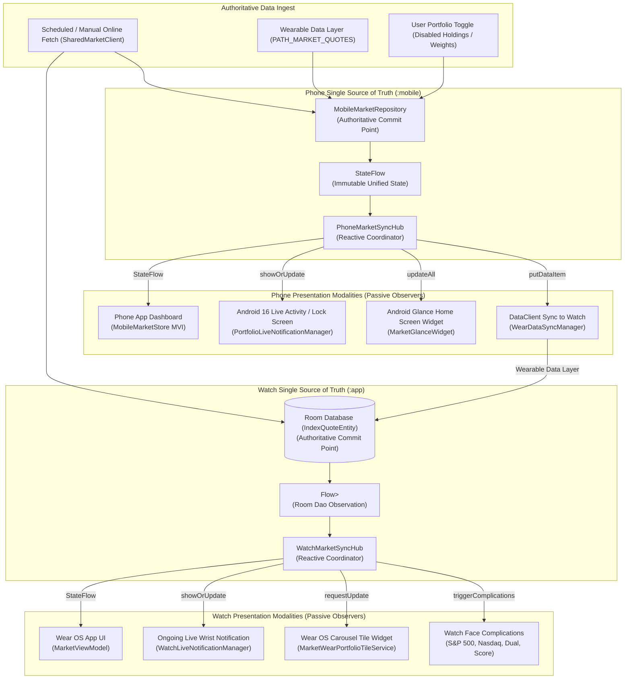
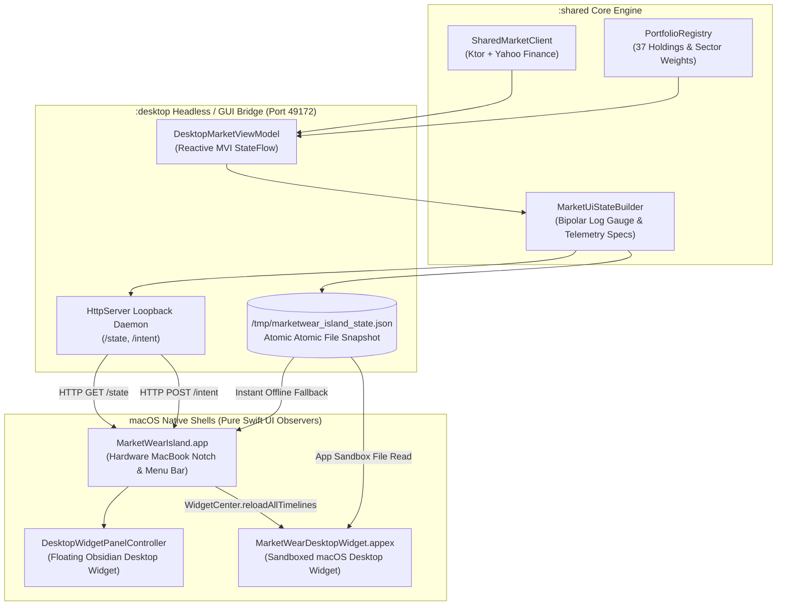

# RFC: Single Source of Truth (SSOT) Multi-Surface Reactive Architecture

**Author**: MarketWear Core Engineering Team  
**Date**: November 23, 2026  
**Status**: Implemented & Approved  
**Affected Modules**: `:shared`, `:mobile`, `:app` (Wear OS), `:desktop`, `:shared-ui`, Web Showcase

---

## 1. Executive Summary & Problem Statement

### 1.1 The Incident
During market open, financial indices and individual portfolio holdings experience rapid price movements. In previous iterations, users observed a fractured, inconsistent user experience:
- The Wear OS watch face complication updated promptly to reflect market changes.
- The watch's persistent ongoing live notification remained stale.
- The paired phone companion app's dashboard remained on previous session prices.
- The Android Glance home screen widget and Android 16 Live Activity status-bar chip did not reflect the updated numbers.

### 1.2 Root Cause Analysis
An architectural post-mortem revealed that events and cache lifetimes were causing desynchronization across disconnected components:
1. **Disconnected Memory Flow**: In `:mobile`, `MobileMarketRepository` maintained an in-memory `MutableStateFlow` disconnected from `PortfolioSelectionStore.cachedQuotes`. Background workers and Wearable listeners updated disk caches or sent messages, but the on-screen MVI store did not observe repository emissions.
2. **Ad-Hoc Imperative Poking**: Modalities (notifications, widgets, tiles, and complications) were updated via disparate, manual method calls scattered throughout `MobileSyncWorker`, `MobileWearableListenerService`, `PortfolioNotificationActionReceiver`, and `MainActivity`. Omitting an update call in any single code path resulted in silent desynchronization.
3. **Market-Open Pre-Market Cache Lock**: `SharedMarketClient` previously had a hardcoded `PORTFOLIO_REFRESH_INTERVAL_MS = 2 * 60 * 60 * 1000L` (2 hours) and mapped `FORCE_CORE_QUOTES` to `portfolioPolicy = CACHE_FIRST`. Any pre-market snapshot cached at 8:30 AM ET was retained past the 9:30 AM ET bell until 10:30 AM ET. Complications showed fresh numbers because individual tickers (`SPX`, `NDX`) had 5-minute TTLs, but the composite `PORTFOLIO` quote remained frozen in cache.
4. **Premature Asynchronous Return on Watch**: `MarketRepository.refreshWithPhoneFallback()` sent `sendMessage(PATH_REQUEST_REFRESH)` and immediately returned `Unit` without fetching local online quotes. If the paired phone was in doze or unreachable, the watch never updated its local Room database.
5. **Local Recalculation Overwrites**: In `MarketViewModel`, `onRecomputeLocalQuotes()` recomputed `PORTFOLIO` from local watch intraday data every time Room emitted, overwriting fresh authoritative portfolio network quotes with older local data.
6. **Notification Weight Mode Divergence**: `WatchPortfolioSelectionStore` lacked `weightMode` flow persistence, causing `WatchMarketSyncHub` to always default wrist notifications to `NORMALIZED_100` even when the app was in `RAW_PORTFOLIO`.
7. **macOS WidgetKit ChronoCore Security Purging**: On macOS Sonoma/Sequoia, `chronod` dropped `MarketWearDesktopWidget.appex` from the desktop "Edit Widgets" gallery because it was ad-hoc signed (`isApple: false`) without an Apple Developer Team ID, its host app had `LSUIElement: true` (background agent rejection), and lacked `CFBundleVersion` (`FOREIGN KEY constraint failed`).

---

## 2. Core Architectural Pillar: Single Source of Truth (SSOT)

To permanently eliminate cross-surface inconsistencies, MarketWear establishes **Single Source of Truth (SSOT)** as the central architectural pillar.

### 2.1 The Golden Invariant
> **No presentation modality or UI surface may fetch data, compute portfolio state, or directly push updates to sibling modalities.**  
> **All presentation modalities are pure, passive, reactive observers of an authoritative local data stream.**



---

## 3. Data Specification & Flow

### 3.1 Immutable Snapshot Model (`MarketSnapshot`)
Located in `:shared` (`commonMain`), `MarketSnapshot` represents the canonical state of the market ecosystem at any given point in time:

```kotlin
data class MarketSnapshot(
    val quotes: List<IndexQuote>,
    val timestampMillis: Long,
    val disabledHoldingIds: Set<String>,
    val customWeights: Map<String, Double>,
    val weightMode: PortfolioWeightMode,
    val tickerIntradayData: Map<String, TickerIntradayData>
)
```

### 3.2 Phone-Side Implementation (`PhoneMarketSyncHub`)
`MobileMarketRepository` serves as the sole commit boundary on the phone. All data arrivals call `commitQuotes(quotes, intraday)`:

1. `commitQuotes()` atomically persists to `PortfolioSelectionStore` and emits a new `MarketSnapshot` onto `snapshotFlow`.
2. `PhoneMarketSyncHub` observes `snapshotFlow`:
   - **Phone UI**: `MobileMarketStore` bootstraps to `repository.snapshotFlow`, emitting `ExternalQuotesUpdated` to maintain real-time on-screen state.
   - **Android 16 Live Updates**: Dispatches to `PortfolioLiveNotificationManager` when preference is active.
   - **Glance Widget**: Triggers `MarketGlanceWidget().updateAll(context)`.
   - **Watch Sync**: Transmits `WearConstants.PATH_MARKET_QUOTES` via `WearDataSyncManager`. Deduplication guarantees `snapshot.quotes != lastSyncedQuotes` to avoid redundant Bluetooth traffic.

### 3.3 Watch-Side Implementation (`WatchMarketSyncHub`)
On Wear OS, Room Database (`IndexQuoteDao`) is the sole local source of truth:

1. Whenever quotes are inserted or updated in Room (via Data Layer from phone or standalone online fetch):
   - `dao.getAllQuotesFlow()` automatically emits.
2. `WatchMarketSyncHub` observes `repository.quotesFlow` alongside holdings configurations:
   - **Watch Face Complications**: Invokes `ComplicationDataSourceUpdateRequester.requestUpdateAll()` across all 4 complication providers.
   - **Wear OS Carousel Tile**: Invokes `TileService.getUpdater(context).requestUpdate(MarketWearPortfolioTileService::class.java)`.
   - **Ongoing Wrist Notification**: Invokes `WatchLiveNotificationManager.showOrUpdateFromQuotes()`.
   - **Watch App UI**: `MarketViewModel` collects `quotesFlow` directly into `MarketStore.Intent.ExternalQuotesUpdated`.

### 3.4 Bidirectional Watch $\leftrightarrow$ Phone Synchronization
- When the phone fetches quotes, it pushes them to the watch via Wearable Data Layer.
- When the watch performs a standalone online fetch (`MarketRepository.refreshAllOnline()`), it inserts into Room and immediately syncs the quotes and intraday cache back to the phone via `syncQuotesToPhone()`.
- The phone receives `PATH_MARKET_QUOTES` in `MobileWearableListenerService` and commits them to `MobileMarketRepository`, ensuring the phone never remains on stale data if the watch refreshed first.

---

### 3.5 Market-Open Boundary & Invalidation Engine (`hasMarketOpenedSince`)
To eliminate the 2-hour pre-market cache lock across the 9:30 AM ET market open:
1. **Cross-Platform Time Boundary**: `hasMarketOpenedSince(lastFetchMillis, currentMillis)` is implemented across all platform targets (`Platform.android.kt`, `Platform.desktop.kt`, `Platform.ios.kt`, `Platform.js.kt`). It converts timestamps to America/New_York local time and determines if a 9:30 AM trading day boundary was crossed.
2. **Adaptive TTL & Invalidation**:
   - During active trading hours (9:30 AM – 4:00 PM ET on weekdays), the cache TTL drops from 2 hours to `ACTIVE_PORTFOLIO_CACHE_MS = 5 * 60 * 1000L` (5 minutes).
   - If `hasMarketOpenedSince()` evaluates to `true`, `isPortfolioCacheValid()` immediately returns `false`, forcing a full quote and portfolio recalculation on the very first sync after 9:30 AM ET.
3. **Forced Refresh Policy**: All manual refresh buttons across phone, watch, desktop notch, and widgets invoke `RefreshPolicy.FORCE_ALL_INCLUDING_PORTFOLIO`.

---

### 3.6 Direct Wrist Network Execution & Authoritative Room Preservation
1. **No Silent Watch Abort**: In `MarketRepository.refreshWithPhoneFallback()`, the watch transmits `PATH_REQUEST_REFRESH` to the phone, but immediately continues to execute `refreshAllOnline()` using its local Ktor client over Wi-Fi, LTE, or Bluetooth proxy. The watch never relies solely on phone responsiveness.
2. **Authoritative Room Preservation**: In `MarketViewModel.onRecomputeLocalQuotes()`, when user-selected holdings and weights are default, the ViewModel preserves the authoritative `PORTFOLIO` quote emitted by the Room database rather than recalculating from potentially stale local ticker intraday data.
3. **Notification Weight Mode Parity**: `WatchPortfolioSelectionStore` exposes a persistent `weightMode: StateFlow<PortfolioWeightMode>`. `WatchMarketSyncHub` observes this flow alongside `quotesFlow`, ensuring wrist notifications reflect the exact same raw or normalized weight mode as the watch and phone UI.

---

### 3.7 Desktop & macOS SSOT Architecture (`:desktop` & `macosApp`)

To extend the Single Source of Truth to the desktop without duplicating networking, parsing, or portfolio calculation algorithms in Swift, MarketWear introduces a headless bridge daemon powered by `:shared` and `:desktop`:



#### Key Design Decisions for macOS:
1. **Zero Swift Networking / Business Logic**:
   - `MarketWearMacApp.swift` contains no `URLRequest` to Yahoo Finance, no custom JSON parsing dictionaries, and no manual portfolio math.
   - All models conform to `KmpDashboardState` and `KmpPortfolioCardState`, directly decoded from the JSON emitted by `MarketUiStateBuilder`.
2. **Native Floating Desktop Widget (`DesktopWidgetPanelController`)**:
   - Provides an obsidian floating desktop widget placed on the desktop wallpaper that updates every second from the KMP bridge.
   - Completely independent of Apple's `chronod` security signing requirements, allowing local ad-hoc developer builds to enjoy full desktop widget telemetry without an Apple Developer certificate.
   - Includes real-time portfolio score, bipolar log gauge, interactive sparkline chart, index chips, manual refresh (`SYNC`), and persistent desktop coordinates.
3. **App Bundle & WidgetKit Container Resolution**:
   - Fixed host app `Info.plist` to include `CFBundleVersion: 1.0`, `CFBundleDisplayName`, and removed `LSUIElement` so LaunchServices and `chronod` recognize `MarketWearIsland.app` as a legitimate interactive application.
   - Linked `Contents/Extensions` alongside `Contents/PlugIns` for universal ExtensionKit discovery.
4. **Headless Daemon Lifecycle**:
   - Spawns via `./start_headless_bridge.sh` running `:desktop:runHeadlessBridge`.
   - `MarketWearKmpRepository.ensureBridgeDaemonRunning()` automatically boots the daemon if loopback is unresponsive.
   - Exposes `/intent?code=REFRESH`, `/intent?code=TOGGLE_MODE`, and scenario triggers.

---

## 4. Guarantees & Non-Functional Requirements

| Metric | Target Guarantee | Verification Mechanism |
| :--- | :--- | :--- |
| **State Consistency** | 100% synchronized across all 9 presentation modalities (Watch Complications, Tile, Ongoing Notification, Watch UI, Phone UI, Glance Widget, Android 16 Live Activity, Desktop Notch Island, and Desktop Widget) | Unit tests, reactive StateFlow, Room observations, and KMP JSON bridge |
| **Dispatch Latency** | $< 50\text{ms}$ process-local dispatch from ingest to all modalities | In-memory coroutine flows (`StateFlow` / Room `Flow` / Loopback HTTP) |
| **Echo Loop Prevention** | Zero cyclic ping-pong syncs across Bluetooth | Quote payload equality deduplication check in `PhoneMarketSyncHub` |
| **Battery & CPU Impact** | Zero redundant wakeups; strictly event-driven observation | Modalities wake only when data actually changes; complications remain offline Room reads |

---

## 5. Architectural Verification & Tests

- **Unit Tests**:
  - `MobileMarketStoreTest`: Verifies MVI store transitions upon external quote snapshot emissions.
  - `DesktopMarketViewModelTest`: Verifies desktop scenario selection, weight mode toggling, and intent dispatches.
  - `SharedModuleTest` & `KoinModuleTest`: Verifies singleton registration of sync hubs.
- **Integration Tests**:
  - Full project compilation via `./gradlew :desktop:desktopTest :shared:testDebugUnitTest`.
  - macOS bundle and widget verification via `pluginkit -m -v -i com.marketwear.macos.island.widget` and `codesign -d --entitlements`.
