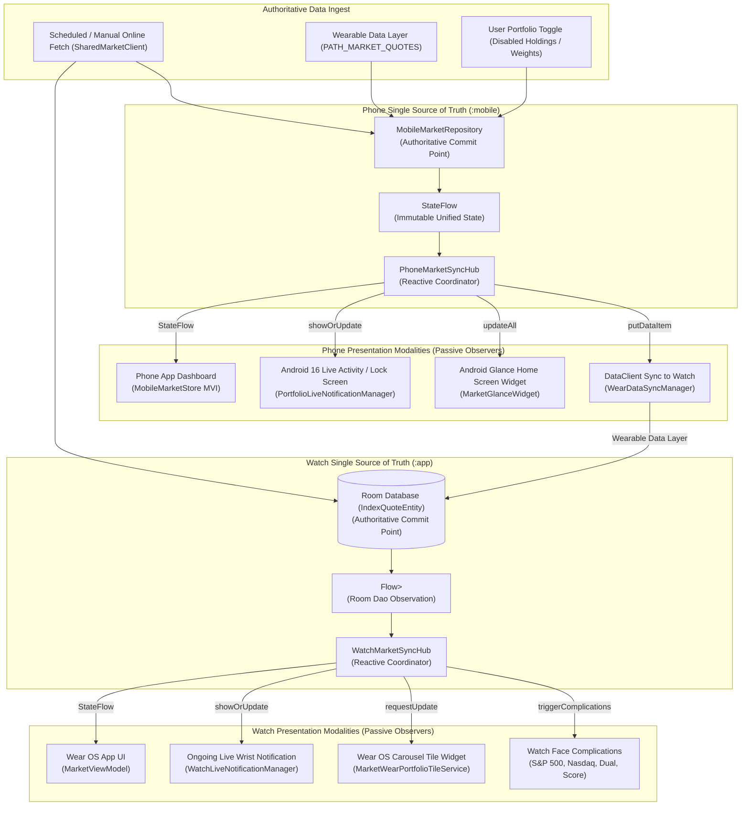

# RFC: Single Source of Truth (SSOT) Multi-Surface Reactive Architecture

**Author**: MarketWear Core Engineering Team  
**Date**: November 23, 2026  
**Status**: Implemented & Approved  
**Affected Modules**: `:shared`, `:mobile`, `:app` (Wear OS), `:desktop`, `:shared-ui`, Web Showcase

---

## 1. Executive Summary & Problem Statement

### 1.1 The Incident
During market open, financial indices and individual portfolio holdings experience rapid price movements. In previous iterations, users observed a fractured, inconsistent user experience:
- The Wear OS watch face complication updated promptly to reflect market changes.
- The watch's persistent ongoing live notification remained stale.
- The paired phone companion app's dashboard remained on previous session prices.
- The Android Glance home screen widget and Android 16 Live Activity status-bar chip did not reflect the updated numbers.

### 1.2 Root Cause Analysis
An architectural post-mortem revealed that events were being passed imperatively in a fragmented, "helter-skelter" manner across disconnected components:
1. **Disconnected Memory Flow**: In `:mobile`, `MobileMarketRepository` maintained an in-memory `MutableStateFlow` disconnected from `PortfolioSelectionStore.cachedQuotes`. Background workers and Wearable listeners updated disk caches or sent messages, but the on-screen MVI store did not observe repository emissions.
2. **Ad-Hoc Imperative Poking**: Modalities (notifications, widgets, tiles, and complications) were updated via disparate, manual method calls scattered throughout `MobileSyncWorker`, `MobileWearableListenerService`, `PortfolioNotificationActionReceiver`, and `MainActivity`. Omitting an update call in any single code path resulted in silent desynchronization.
3. **Unidirectional Watch Updates**: When the watch fetched quotes directly online via `MarketRepository.refreshAllOnline()`, it updated local Room database entities and triggered complication update requesters, but failed to notify `WatchLiveNotificationManager`, failed to invalidate `MarketWearPortfolioTileService`, and failed to push fresh quotes back to the paired phone.

---

## 2. Core Architectural Pillar: Single Source of Truth (SSOT)

To permanently eliminate cross-surface inconsistencies, MarketWear establishes **Single Source of Truth (SSOT)** as the central architectural pillar.

### 2.1 The Golden Invariant
> **No presentation modality or UI surface may fetch data, compute portfolio state, or directly push updates to sibling modalities.**  
> **All presentation modalities are pure, passive, reactive observers of an authoritative local data stream.**



---

## 3. Data Specification & Flow

### 3.1 Immutable Snapshot Model (`MarketSnapshot`)
Located in `:shared` (`commonMain`), `MarketSnapshot` represents the canonical state of the market ecosystem at any given point in time:

```kotlin
data class MarketSnapshot(
    val quotes: List<IndexQuote>,
    val timestampMillis: Long,
    val disabledHoldingIds: Set<String>,
    val customWeights: Map<String, Double>,
    val weightMode: PortfolioWeightMode,
    val tickerIntradayData: Map<String, TickerIntradayData>
)
```

### 3.2 Phone-Side Implementation (`PhoneMarketSyncHub`)
`MobileMarketRepository` serves as the sole commit boundary on the phone. All data arrivals call `commitQuotes(quotes, intraday)`:

1. `commitQuotes()` atomically persists to `PortfolioSelectionStore` and emits a new `MarketSnapshot` onto `snapshotFlow`.
2. `PhoneMarketSyncHub` observes `snapshotFlow`:
   - **Phone UI**: `MobileMarketStore` bootstraps to `repository.snapshotFlow`, emitting `ExternalQuotesUpdated` to maintain real-time on-screen state.
   - **Android 16 Live Updates**: Dispatches to `PortfolioLiveNotificationManager` when preference is active.
   - **Glance Widget**: Triggers `MarketGlanceWidget().updateAll(context)`.
   - **Watch Sync**: Transmits `WearConstants.PATH_MARKET_QUOTES` via `WearDataSyncManager`. Deduplication guarantees `snapshot.quotes != lastSyncedQuotes` to avoid redundant Bluetooth traffic.

### 3.3 Watch-Side Implementation (`WatchMarketSyncHub`)
On Wear OS, Room Database (`IndexQuoteDao`) is the sole local source of truth:

1. Whenever quotes are inserted or updated in Room (via Data Layer from phone or standalone online fetch):
   - `dao.getAllQuotesFlow()` automatically emits.
2. `WatchMarketSyncHub` observes `repository.quotesFlow` alongside holdings configurations:
   - **Watch Face Complications**: Invokes `ComplicationDataSourceUpdateRequester.requestUpdateAll()` across all 4 complication providers.
   - **Wear OS Carousel Tile**: Invokes `TileService.getUpdater(context).requestUpdate(MarketWearPortfolioTileService::class.java)`.
   - **Ongoing Wrist Notification**: Invokes `WatchLiveNotificationManager.showOrUpdateFromQuotes()`.
   - **Watch App UI**: `MarketViewModel` collects `quotesFlow` directly into `MarketStore.Intent.ExternalQuotesUpdated`.

### 3.4 Bidirectional Watch $\leftrightarrow$ Phone Synchronization
- When the phone fetches quotes, it pushes them to the watch via Wearable Data Layer.
- When the watch performs a standalone online fetch (`MarketRepository.refreshAllOnline()`), it inserts into Room and immediately syncs the quotes and intraday cache back to the phone via `syncQuotesToPhone()`.
- The phone receives `PATH_MARKET_QUOTES` in `MobileWearableListenerService` and commits them to `MobileMarketRepository`, ensuring the phone never remains on stale data if the watch refreshed first.

---

## 4. Guarantees & Non-Functional Requirements

| Metric | Target Guarantee | Verification Mechanism |
| :--- | :--- | :--- |
| **State Consistency** | 100% synchronized across all 7 presentation modalities | Unit tests & reactive Flow observation |
| **Dispatch Latency** | $< 50\text{ms}$ process-local dispatch from ingest to all modalities | In-memory coroutine flows (`StateFlow` / Room `Flow`) |
| **Echo Loop Prevention** | Zero cyclic ping-pong syncs across Bluetooth | Quote payload equality deduplication check in `PhoneMarketSyncHub` |
| **Battery Impact** | Zero redundant wakeups; strictly event-driven observation | Modalities wake only when data actually changes; complications remain offline Room reads |

---

## 5. Architectural Verification & Tests

- **Unit Tests**:
  - `MobileMarketStoreTest`: Verifies MVI store transitions upon external quote snapshot emissions.
  - `SharedModuleTest` & `KoinModuleTest`: Verifies singleton registration of sync hubs.
- **Integration Tests**:
  - Full project compilation via `./gradlew test :app:assembleDebug :mobile:assembleDebug`.
